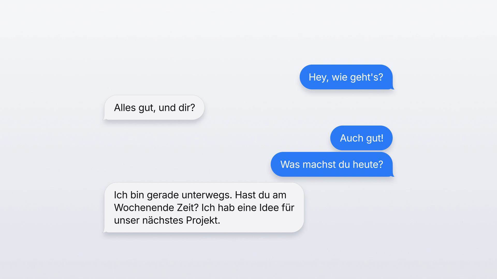
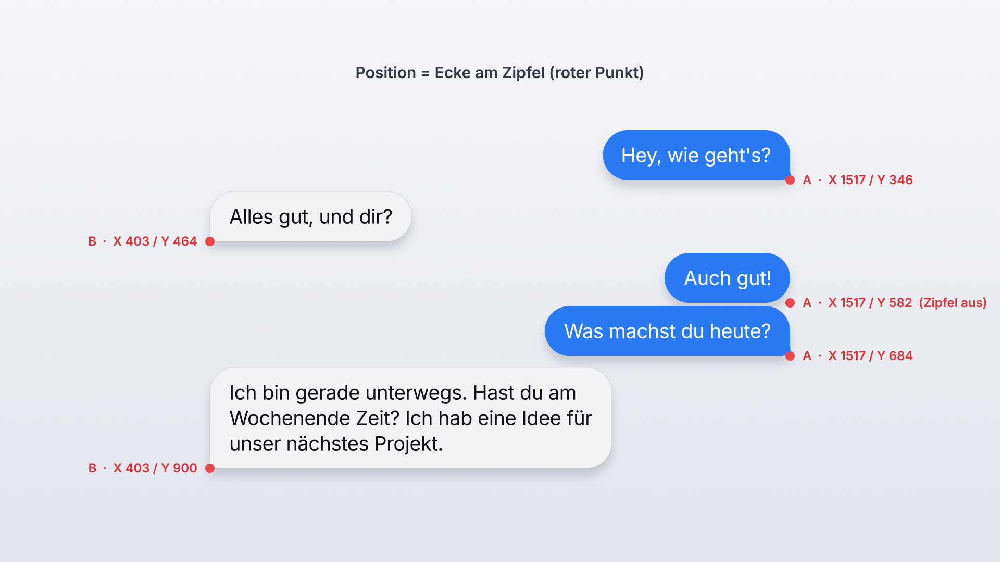
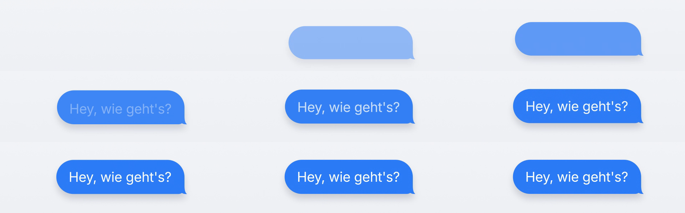
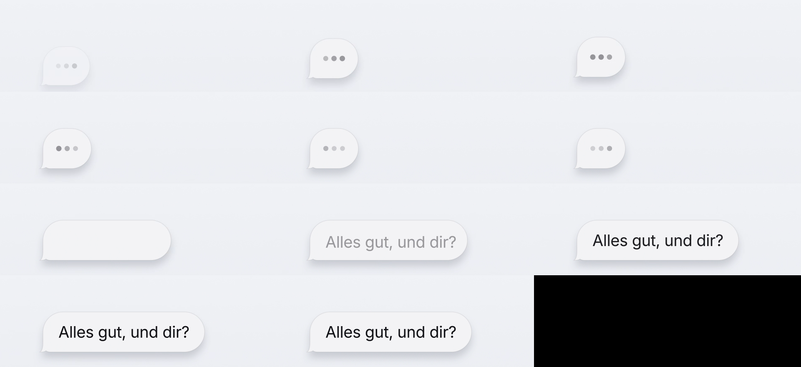

# Tutorial: Chat-Bubbles in Premiere Pro

Diese Anleitung erklärt Schritt für Schritt, wie du die animierten Chat-Blasen in Premiere Pro 2027 verwendest.



---

## Inhalt

0. [Einmalige Einrichtung](#0-einmalige-einrichtung)
1. [Template-Projekt anlegen und öffnen](#1-template-projekt-anlegen-und-öffnen)
2. [Eine Sprechblase auswählen](#2-eine-sprechblase-auswählen)
3. [Eine Sprechblase kopieren](#3-eine-sprechblase-kopieren)
4. [In ein anderes Projekt einfügen](#4-in-ein-anderes-projekt-einfügen)
5. [Den Text ändern](#5-den-text-ändern)
6. [Die Position ändern](#6-die-position-ändern)
7. [Die Dauer ändern](#7-die-dauer-ändern)
8. [Mehrere Sprechblasen kombinieren](#8-mehrere-sprechblasen-kombinieren)
9. [Person A und Person B verwenden](#9-person-a-und-person-b-verwenden)
10. [Tipp-Anzeige „…“](#10-tipp-anzeige-)
11. [Nachrichten gruppieren (Zipfel aus)](#11-nachrichten-gruppieren-zipfel-aus)
12. [Größe und 4K-Sequenzen](#12-größe-und-4k-sequenzen)
13. [Häufige Probleme](#13-häufige-probleme)
14. [Design ändern](#14-design-ändern)

---

## Die zwei Vorlagen

| Vorlage | Aussehen | Seite | Standard-Position |
|---|---|---|---|
| `CHAT_BUBBLE_PERSON_A` | Blau, weißer Text | rechts, Zipfel rechts unten | X 1517 |
| `CHAT_BUBBLE_PERSON_B` | Hellgrau, dunkler Text | links, Zipfel links unten | X 403 |

Jede Blase ist ein **eigener Clip** mit eigener Animation. Blasen hängen nicht voneinander ab.

### Die Regler jeder Blase

| Regler | Bedeutung |
|---|---|
| **Nachricht** | Der Text. Lange Texte brechen automatisch um. Die Blase wächst mit. |
| **Position (Ecke am Zipfel)** | Der Punkt unten am Zipfel. Die Blase wächst von dort nach oben und zur Seite. |
| **Zipfel anzeigen** | Aus = Blase ohne Zipfel (für gruppierte Nachrichten). |
| **Tipp-Anzeige …** | An = Zuerst erscheinen drei Punkte, dann verwandelt sich die Blase in die Nachricht. |
| **Tipp-Dauer (Sek.)** | Wie lange die Punkte zu sehen sind (Standard 1,2 s). |
| **Größe (%)** | Skaliert die ganze Blase um den Zipfel herum (Standard 100). |

---

## 0. Einmalige Einrichtung

> Auf **diesem Mac** ist beides schon erledigt. Diese Schritte brauchst du nur auf einem anderen Computer.

**Schritt 1: Schrift installieren**
1. Öffne den Ordner `Fonts/`.
2. Doppelklicke `Inter-Regular.otf`, `Inter-Medium.otf` und `Inter-SemiBold.otf` nacheinander.
3. Klicke jeweils auf **Installieren**.
4. Starte Premiere Pro neu, falls es geöffnet war.

> Ohne Inter setzt Premiere eine Ersatzschrift ein. Dann passen die Abstände nicht mehr.

**Schritt 2: Vorlagen installieren**
1. Öffne Premiere Pro.
2. Wähle im Menü **Grafiken und Titel → Motion Graphics-Vorlage installieren …**.
3. Wähle `MOGRT/CHAT_BUBBLE_PERSON_A.mogrt`.
4. Wiederhole das mit `MOGRT/CHAT_BUBBLE_PERSON_B.mogrt`.

Alternativ kopierst du beide Dateien in diesen Ordner:
`~/Library/Application Support/Adobe/Common/Motion Graphics Templates/Chat Bubbles/`

---

## 1. Template-Projekt anlegen und öffnen

**Das Template-Projekt ist schon fertig.** Doppelklicke `Premiere_Project/Chat_Bubble_Template.prproj` oder öffne es in Premiere über **Datei → Öffnen …**.

Es enthält:
- die Sequenz **CHAT_BEISPIEL**: Hintergrund auf V1, fünf Beispiel-Nachrichten auf V2 bis V6,
- im Projektfenster beide Vorlagen.

> Der Ordner `Premiere_Project/Motion Graphics Template Media/` gehört zum Projekt. Nicht löschen. Wenn du das Projekt woanders hin kopierst, nimm ihn mit.

Die folgenden Schritte brauchst du nur, wenn du ein solches Projekt **von Hand neu** anlegen möchtest (ca. 3 Minuten).

**Projekt anlegen**
1. Öffne **Premiere Pro 2027**.
2. Wähle **Datei → Neu → Projekt …**.
3. Projektname: `Chat_Bubble_Template`.
4. Speicherort: Ordner `Premiere_Project/` in diesem Template-Ordner.
5. Bestätige mit **Erstellen**.

**Sequenz anlegen**
1. Wähle **Datei → Neu → Sequenz …**.
2. Wechsle zum Tab **Einstellungen** und stelle ein:
   - Bearbeitungsmodus: **Benutzerdefiniert**
   - Zeitbasis: **30 Frames/Sekunde** (nicht 29,97. Viele „30p“-Vorgaben sind in Wahrheit 29,97.)
   - Framegröße: **1920 × 1080**
   - Pixel-Seitenverhältnis: **Quadratische Pixel (1.0)**
3. Sequenzname: `CHAT_BEISPIEL`.
4. Bestätige mit **OK**.

**Vorlagen ins Projekt holen**
1. Wähle **Datei → Importieren …**.
2. Wähle beide `.mogrt`-Dateien aus dem Ordner `MOGRT/`.
3. Sie erscheinen im Projektfenster als `CHAT_BUBBLE_PERSON_A` und `CHAT_BUBBLE_PERSON_B`.

**Beispiel-Chat bauen**

Baue den Beispiel-Chat aus [Abschnitt 8](#8-mehrere-sprechblasen-kombinieren) nach. Speichere dann mit **⌘ S**.

**Später wieder öffnen**

Doppelklicke `Premiere_Project/Chat_Bubble_Template.prproj`. Oder wähle in Premiere **Datei → Zuletzt verwendete Projekte**.

> Ein Projekt aus Premiere 2027 lässt sich in Premiere 2026 **nicht** öffnen.

---

## 2. Eine Sprechblase auswählen

1. Klicke in der **Timeline** auf den Clip der Blase.
   - Jede Blase liegt auf einer eigenen Videospur.
   - Der Clipname ist `CHAT_BUBBLE_PERSON_A` oder `CHAT_BUBBLE_PERSON_B`.
2. Mehrere Blasen wählst du mit **⇧ Shift + Klick** aus. Oder du ziehst mit der Maus einen Rahmen um die Clips.
3. Die Regler der ausgewählten Blase findest du an zwei Stellen:
   - im Panel **Grundlegende Grafiken** (**Fenster → Grundlegende Grafiken**, Bereich **Bearbeiten**),
   - in den **Effekteinstellungen** (**Fenster → Effekteinstellungen**).

---

## 3. Eine Sprechblase kopieren

**Innerhalb derselben Sequenz (duplizieren)**
1. Halte **⌥ Alt** gedrückt.
2. Ziehe den Clip auf eine freie Spur darüber.
3. Die Kopie ist **vollständig unabhängig**. Text, Position und Einstellungen änderst du getrennt vom Original.

**Für ein anderes Projekt**
1. Wähle den Clip oder mehrere Clips aus.
2. Drücke **⌘ C**.

---

## 4. In ein anderes Projekt einfügen

**Weg 0: Ganze Chat-Sequenz übernehmen** (getestet ✅)
1. Öffne das Zielprojekt.
2. Wähle **Datei → Importieren …** und dann `Premiere_Project/Chat_Bubble_Template.prproj`.
3. Wähle **Ausgewählte Sequenzen importieren** und dann `CHAT_BEISPIEL`.
4. Alle Blasen kommen mit Text, Position und Einstellungen an. Danach kopierst du einzelne Blasen innerhalb des Zielprojekts per ⌥ Alt-Ziehen oder ⌘C/⌘V.

**Weg A: Kopieren und Einfügen** (behält Text, Position und alle Einstellungen)
1. Öffne das Zielprojekt. Premiere kann mehrere Projekte gleichzeitig offen haben.
2. Öffne die Zielsequenz.
3. Setze den Abspielkopf an die gewünschte Stelle.
4. Wähle die Zielspur.
5. Drücke **⌘ V**.

Die Vorlage wird dabei automatisch ins Zielprojekt übernommen. Externe Dateien sind nicht nötig, nur die Schrift Inter muss installiert sein.

**Weg B: Frische Blase aus der Bibliothek**
1. Öffne **Fenster → Grundlegende Grafiken → Durchsuchen**. In neueren Versionen heißt das Panel auch **Fenster → Grafikvorlagen**.
2. Suche nach `CHAT_BUBBLE`.
3. Ziehe die Vorlage in die Timeline.

**Weg C: Direkt aus dem Finder**
- Ziehe eine `.mogrt`-Datei aus `MOGRT/` direkt in die Timeline.

---

## 5. Den Text ändern

1. Wähle die Blase aus.
2. Klicke im Panel **Grundlegende Grafiken → Bearbeiten** in das Feld **Nachricht**.
3. Tippe deinen Text.

Gut zu wissen:
- **Zeilenumbruch** passiert automatisch ab etwa 760 px Textbreite. Das sind etwa 38 bis 42 Zeichen pro Zeile.
- **Eigener Umbruch:** Drücke im Textfeld **Enter**.
- Die Blase passt Breite und Höhe **automatisch** an.
- Den Text änderst du im Panel, nicht direkt im Programmmonitor. Das ist bei After-Effects-Vorlagen in Premiere immer so.

---

## 6. Die Position ändern



**Die Position ist immer die Ecke am Zipfel (roter Punkt):**
- Person A: unten rechts
- Person B: unten links

Die Blase wächst von diesem Punkt **nach oben** und zur Seite. Eine längere Nachricht schiebt sich deshalb nie in die Blase darunter.

**Position einstellen**
1. Wähle die Blase aus.
2. Ändere unter **Position (Ecke am Zipfel)** die Werte **X** und **Y**.

**Empfohlene X-Werte (Chat-Spalte in der Bildmitte)**
- Person A: **X = 1517**
- Person B: **X = 403**

Du kannst aber jeden beliebigen Wert verwenden.

**Y-Werte berechnen**

Höhe einer Blase (bei Größe 100 %):

| Zeilen | Höhe (px) |
|---|---|
| 1 | 96 |
| 2 | 145 |
| 3 | 194 |
| 4 | 243 |
| 5 | 292 |

(+ 49 px je weitere Zeile)

Abstand zwischen zwei Blasen:

| Situation | Abstand |
|---|---|
| Anderer Absender oder neue Gruppe | **22 px** |
| Gleiche Person, gruppiert | **6 px** |

Formel für die nächste Blase (darunter):

```
Y neu = Y vorherige Blase + Abstand + Höhe der neuen Blase
```

Beispiel aus dem Bild, mit Start bei Y = 250:

| # | Person | Zeilen | Rechnung | Y |
|---|---|---|---|---|
| 1 | A | 1 | 250 + 96 | **346** |
| 2 | B | 1 | 346 + 22 + 96 | **464** |
| 3 | A (Zipfel aus) | 1 | 464 + 22 + 96 | **582** |
| 4 | A | 1 | 582 + 6 + 96 | **684** |
| 5 | B | 3 | 684 + 22 + 194 | **900** |

**Andere Wege, eine Blase zu verschieben**
- **Effekteinstellungen → Bewegung → Position** verschiebt den ganzen Clip. Das geht auch direkt durch Ziehen im Programmmonitor, wenn „Bewegung“ angeklickt ist.
- **Ganzen Chat verschieben:** Wähle alle Blasen aus, Rechtsklick → **Verschachteln …**. Dann verschiebst oder skalierst du die verschachtelte Sequenz als Ganzes.
- **Scroll-Effekt:** Setze bei **Position (Ecke am Zipfel)** in den Effekteinstellungen Keyframes über die Stoppuhr. Damit wandern ältere Blasen nach oben, wenn neue dazukommen.

---

## 7. Die Dauer ändern

So läuft die Einblendung ab (0,7 s, der Text folgt 0,2 s später):



- **Wann die Blase erscheint:** Verschiebe den Clip in der Timeline. Der **Clipanfang** ist der Moment, in dem die Blase (oder die Tipp-Anzeige) startet.
- **Wie lange sie sichtbar bleibt:** Ziehe das **Clipende** länger oder kürzer.
  - Die Einblendung (erste 4 Sekunden) ist **geschützt**. Sie bleibt immer gleich schnell, egal wie lang der Clip ist.
  - Der Clip sollte mindestens so lang sein wie die Einblendung: etwa 1 s, mit Tipp-Anzeige Tipp-Dauer + 1 s.
- **Ausblenden am Ende (optional):** Lege eine **Blende** auf das Clipende (Effekte → Videoüberblendungen → Überblenden → **Blende**). Alternativ setzt du Deckkraft-Keyframes.

---

## 8. Mehrere Sprechblasen kombinieren

Das Grundprinzip:
- **Eine Blase = ein Clip = eine eigene Videospur.**
- Neuere Nachrichten liegen auf höheren Spuren.
- Alle Clips **enden gleichzeitig**. So bleibt der Chat stehen, bis die Szene endet.

```
V6  |                         [ B: Ich bin gerade unterwegs …  ]
V5  |                   [ A: Was machst du heute?             ]
V4  |                [ A: Auch gut!  (Zipfel aus)              ]
V3  |      [ B: Alles gut, und dir?  (Tipp-Anzeige an)         ]
V2  | [ A: Hey, wie geht's?                                    ]
V1  | [ Hintergrund / Footage                                  ]
    0s    1.4s       3.3s 3.9s     4.9s                      10s
```

**Beispiel-Chat Schritt für Schritt**
1. Lege dein Video oder einen Hintergrund auf **V1**.
2. Ziehe `CHAT_BUBBLE_PERSON_A` auf **V2** bei 0:00.
   - Nachricht: „Hey, wie geht's?“
   - Position: 1517 / 346
3. Ziehe `CHAT_BUBBLE_PERSON_B` auf **V3** bei ca. 1,4 s.
   - Nachricht: „Alles gut, und dir?“
   - Tipp-Anzeige: an
   - Position: 403 / 464
4. Ziehe A mit **⌥ Alt** von V2 auf **V4** und lass den Clip bei ca. 3,3 s beginnen.
   - Nachricht: „Auch gut!“
   - Zipfel anzeigen: **aus**
   - Position: 1517 / 582
5. Dupliziere noch einmal auf **V5**, Start bei ca. 3,9 s.
   - Nachricht: „Was machst du heute?“
   - Zipfel: an
   - Position: 1517 / 684
6. Dupliziere B auf **V6**, Start bei ca. 4,9 s.
   - Langer Text, Tipp-Anzeige an
   - Position: 403 / 900
7. Ziehe alle Clip-Enden auf dieselbe Stelle.

**Tipps**
- **Timing:** Zwischen zwei Nachrichten wirken ca. 0,6 bis 1,2 s natürlich. Mit Tipp-Anzeige plane die Tipp-Dauer zusätzlich ein.
- **Spuren hinzufügen:** Rechtsklick auf den Spurkopf → **Spuren hinzufügen …**.
- **Es gibt keine Begrenzung** der Nachrichtenanzahl.

---

## 9. Person A und Person B verwenden

| | Person A | Person B |
|---|---|---|
| Vorlage | `CHAT_BUBBLE_PERSON_A` | `CHAT_BUBBLE_PERSON_B` |
| Farbe | Blau `#2A7AF5`, weißer Text | Hellgrau `#F3F3F5` mit feiner Linie, Text `#111216` |
| Seite / Zipfel | rechts | links |
| Typische Rolle | „Ich“ (Absender) | Gesprächspartner |

- Nimm einfach die passende Vorlage. **Umbauen ist nie nötig.**
- Soll der Gesprächspartner rechts stehen? Dann tausche die Rollen: Person A ist dann der Gesprächspartner.

---

## 10. Tipp-Anzeige „…“



1. Aktiviere **Tipp-Anzeige …**.
2. Stelle bei **Tipp-Dauer (Sek.)** ein, wie lange die Punkte pulsieren. Werte von 0,3 bis 3 s sind sinnvoll.

Danach wächst die Blase auf Nachrichtengröße, und der Text blendet ein.

> Der Clipanfang ist dann der Beginn der **Punkte**, nicht der Nachricht.

---

## 11. Nachrichten gruppieren (Zipfel aus)

Wie bei iMessage hat bei mehreren Nachrichten hintereinander von derselben Person **nur die letzte** einen Zipfel.

1. Schalte bei allen Nachrichten der Gruppe außer der letzten **Zipfel anzeigen** aus.
2. Nimm zwischen den Blasen der Gruppe **6 px** Abstand statt 22 px (siehe [Abschnitt 6](#6-die-position-ändern)).

---

## 12. Größe und 4K-Sequenzen

- **Größe (%)** skaliert die Blase um die Zipfel-Ecke. Bei Größe ≠ 100 % multiplizierst du die Höhen und Abstände aus Abschnitt 6 mit dem Faktor.
- Die Vorlagen sind für **1920 × 1080** gebaut.
- In einer **4K-Sequenz (3840 × 2160)** setzt du:
  - Größe auf **200 %**,
  - X/Y-Werte doppelt so groß (A: X 3034, B: X 806).
- Andere Bildraten (25, 50, 60 fps) funktionieren. Die Animation läuft zeitbasiert.

---

## 13. Häufige Probleme

| Problem | Lösung |
|---|---|
| Schrift sieht anders aus oder rote Schrift-Warnung | Inter aus `Fonts/` installieren und Premiere neu starten. |
| Wiedergabe ruckelt | After-Effects-Vorlagen sind rechenintensiv (vor allem mit 8 GB RAM). Lösungen: **Sequenz → In/Out rendern** (Enter-Taste) oder die Wiedergabeauflösung im Programmmonitor auf ½ stellen. |
| Blasen überdecken sich | Y-Abstände nach der Tabelle in Abschnitt 6 setzen. Neuere Nachrichten auf höhere Spuren legen. |
| Animation ist langsamer als erwartet | Der Clip wurde vielleicht über **Geschwindigkeit/Dauer** gedehnt. Auf 100 % zurücksetzen und die Länge nur durch Trimmen ändern. |
| Blase ist zu breit | Die maximale Textbreite liegt bei 760 px. Bei Bedarf manuell mit Enter umbrechen. |
| Vorlage fehlt in „Durchsuchen“ | Schritt 0 wiederholen oder die `.mogrt` direkt aus dem Finder in die Timeline ziehen. |

---

## 14. Design ändern

Das komplette Design entsteht über das Skript `Scripts/build_chat_bubbles.jsx`. Dort stehen oben Farben, Schrift, Größen und Zeiten.

**Neu bauen**
1. In After Effects 2027: **Einstellungen → Skripterstellung und Ausdrücke** → „Skripten das Schreiben von Dateien … erlauben“ aktivieren.
2. **Datei → Skripte → Skriptdatei ausführen …** → `Scripts/build_chat_bubbles.jsx`.
3. Das Skript erzeugt neu:
   - `AE_Source/Chat_Bubble_Template.aep`
   - beide `.mogrt` in `MOGRT/`
   - `Preview/prototyp_chat.mp4`
4. Neue `.mogrt` wie in Schritt 0 installieren.

> **Wichtig:** Bereits in Premiere verwendete Blasen behalten ihre alte Version. Nur neu eingefügte Blasen nutzen das neue Design.
