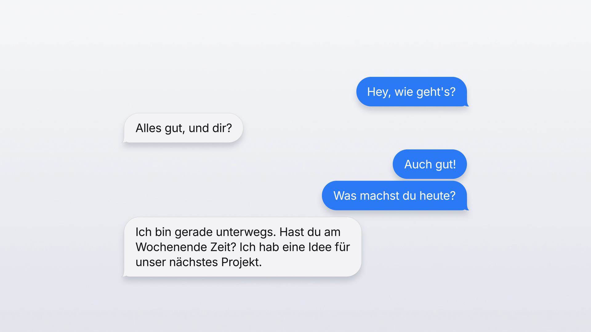

# Chat Bubble Template für Premiere Pro

Animierte Chat-Nachrichten im Stil von Apple iMessage (Design „Minimal Premium“) für Premiere Pro 2027.

- Zwei fertige Vorlagen: **Person A** (blau, rechts) und **Person B** (grau, links)
- Die Blase passt sich automatisch an den Text an
- Eigene Einblend-Animation pro Blase
- Optionale Tipp-Anzeige „…“
- Beliebig viele Blasen kombinierbar, jede Blase ist unabhängig

**Die komplette Schritt-für-Schritt-Anleitung findest du hier: [Documentation/TUTORIAL.md](Documentation/TUTORIAL.md)**

---

## Herunterladen

Klicke oben auf dieser Seite auf **Code → Download ZIP** und entpacke den Ordner. Git ist dafür nicht nötig.

Voraussetzungen:
- **Premiere Pro 2027**. Das Template-Projekt lässt sich in 2026 nicht öffnen.
- die Schrift **Inter** aus `Fonts/` (Doppelklick, dann „Installieren“)

## Schnellstart

1. Installiere die Schrift **Inter** aus `Fonts/`.
2. Ziehe in Premiere Pro `MOGRT/CHAT_BUBBLE_PERSON_A.mogrt` oder `…_B.mogrt` in die Timeline.
   - Alternativ: **Grundlegende Grafiken → Durchsuchen → „CHAT_BUBBLE“**.
3. Wähle den Clip aus und ändere im Panel **Grundlegende Grafiken** die **Nachricht** und die **Position**.
4. Für weitere Nachrichten den Clip mit **⌥ Alt** auf eine höhere Spur ziehen. Jede Nachricht bekommt eine eigene Spur.

---

## Ordnerstruktur

| Ordner / Datei | Inhalt |
|---|---|
| `MOGRT/` | **Die Vorlagen** `CHAT_BUBBLE_PERSON_A.mogrt` und `CHAT_BUBBLE_PERSON_B.mogrt` |
| `Premiere_Project/` | **Das Template-Projekt** `Chat_Bubble_Template.prproj` mit der Sequenz `CHAT_BEISPIEL`. Der Unterordner `Motion Graphics Template Media` gehört dazu: nicht löschen, beim Kopieren mitnehmen. |
| `AE_Source/` | After-Effects-Quellprojekt `Chat_Bubble_Template.aep` |
| `Assets/` | Hintergrundbild für die Beispiel-Sequenz |
| `Scripts/` | `build_chat_bubbles.jsx` baut die Vorlagen in AE neu. `premiere_build_template_project.jsx` baut das Premiere-Projekt neu. |
| `Fonts/` | Schrift Inter (Regular, Medium, SemiBold) und Lizenz (SIL OFL, frei verwendbar) |
| `Preview/` | `prototyp_chat.mp4` (Vorschau-Video) und `design_richtungen.html` (Designvergleich) |
| `Documentation/` | `TUTORIAL.md` und Bilder |
| `Exports/` | Für deine eigenen Exporte |

---

## Regler pro Blase

| Regler | Funktion |
|---|---|
| Nachricht | Text, wird automatisch umgebrochen (max. ca. 760 px Breite) |
| Position (Ecke am Zipfel) | Ankerpunkt unten am Zipfel. Die Blase wächst nach oben. |
| Zipfel anzeigen | Aus = für gruppierte Nachrichten derselben Person |
| Tipp-Anzeige … | Drei pulsierende Punkte, die sich dann in die Nachricht verwandeln |
| Tipp-Dauer (Sek.) | Dauer der Punkte (Standard 1,2 s) |
| Größe (%) | Skaliert die Blase (200 % für 4K) |

**Positions-Faustregel (1080p):**
- X-Werte: Person A **X 1517**, Person B **X 403**.
- Höhe einer Blase: 96 px + 49 px je weitere Zeile.
- Abstand: 22 px zwischen verschiedenen Personen, 6 px innerhalb einer Gruppe.
- Rechnung: Y neu = Y vorher + Abstand + Höhe der neuen Blase.

---

## Technik

- Die Vorlagen sind **Motion-Graphics-Templates (.mogrt)**. Sie wurden per Skript in After Effects 2027 gebaut.
- Premiere Pro braucht zum Abspielen **kein** installiertes After Effects.
- Die Animation läuft über Expressions in der Vorlage:
  - Glide-Einblendung (0,7 s, ohne Überschwingen)
  - Text folgt 0,2 s versetzt
  - Tipp-Punkte mit Übergang in die Blase
- Die ersten 4 Sekunden sind als geschützter Bereich markiert. Ein längerer Clip verlangsamt die Einblendung also nicht.
- Die Blasengröße berechnet sich live aus dem Text. Es gibt keine festen Größen und keine PNGs.

## Bekannte Einschränkungen

- **Text bearbeiten** geht im Panel „Grundlegende Grafiken“, nicht direkt im Programmmonitor.
- **Kein echter Glas-Weichzeichner:** Eine Vorlage kann das Video darunter nicht weichzeichnen. Der Look kommt aus Farbe, Linie und Schatten.
- **Leistung:** After-Effects-Vorlagen sind rechenintensiv. Bei ruckelnder Wiedergabe den Bereich rendern (Enter).
- **Stapeln ist manuell:** Die Blasen wissen nichts voneinander. Abstände stellst du über die Y-Position ein (Tabelle im Tutorial).
- **Schrift:** Inter muss auf jedem Rechner installiert sein, der die Blasen bearbeitet oder rendert.
- **Premiere-Version:** Das Projekt ist für Premiere 2027 vorgesehen. Projekte aus 2027 öffnen sich nicht in 2026.
- **Premiere lässt sich nicht direkt fernsteuern.** Das Template-Projekt wurde über eine vorübergehend installierte Test-Erweiterung erzeugt. Diese ist inzwischen wieder entfernt.

## Teststatus

| Test | Status |
|---|---|
Getestet am 25.11.2026 mit After Effects 2027 (27.0) und Premiere Pro 2027 (27.0.0) auf macOS. Geprüft wurde jeweils an Einzelbildern, die aus Premiere exportiert wurden.

| # | Test | Ergebnis |
|---|---|---|
| 1 | Einzelne Sprechblase in Premiere | ✅ rendert identisch zum AE-Original |
| 2 | Kurze Nachricht | ✅ |
| 3 | Lange Nachricht (3 Zeilen), automatischer Umbruch und Größe | ✅ |
| 4 | Mehrere Sprechblasen hintereinander (5 Spuren) | ✅ |
| 5 | Person A und B im Wechsel | ✅ |
| 6 | Mehrere Nachrichten derselben Person (Zipfel aus) | ✅ |
| 7 | Übernahme in ein **neues** Projekt (Sequenz importiert) | ✅ Text, Position, Zipfel, Tipp-Anzeige und Timing bleiben erhalten. Keine externen Dateien nötig. |
| 8 | Unabhängig bearbeiten | ✅ Text einer Kopie geändert: Die Blase passt sich neu an, andere Blasen und das Original-Projekt bleiben unverändert. |
| – | Clip von 10 s auf 40 s verlängert | ✅ Einblendung pixelgleich, also nicht verlangsamt |
| – | Tipp-Anzeige in Premiere | ✅ |
| – | Umlaute (ä, ö, ü) | ✅ |
| – | Kopieren/Einfügen per ⌘C/⌘V zwischen zwei offenen Projekten | ⚠️ nicht automatisch testbar (Tastatursteuerung braucht eine macOS-Berechtigung). Bitte einmal von Hand prüfen. Die Übernahme an sich (Test 7) funktioniert. |
| – | Wiedergabe-Leistung in Echtzeit | ⚠️ nicht gemessen. Bei Ruckeln rendern (Enter). |
